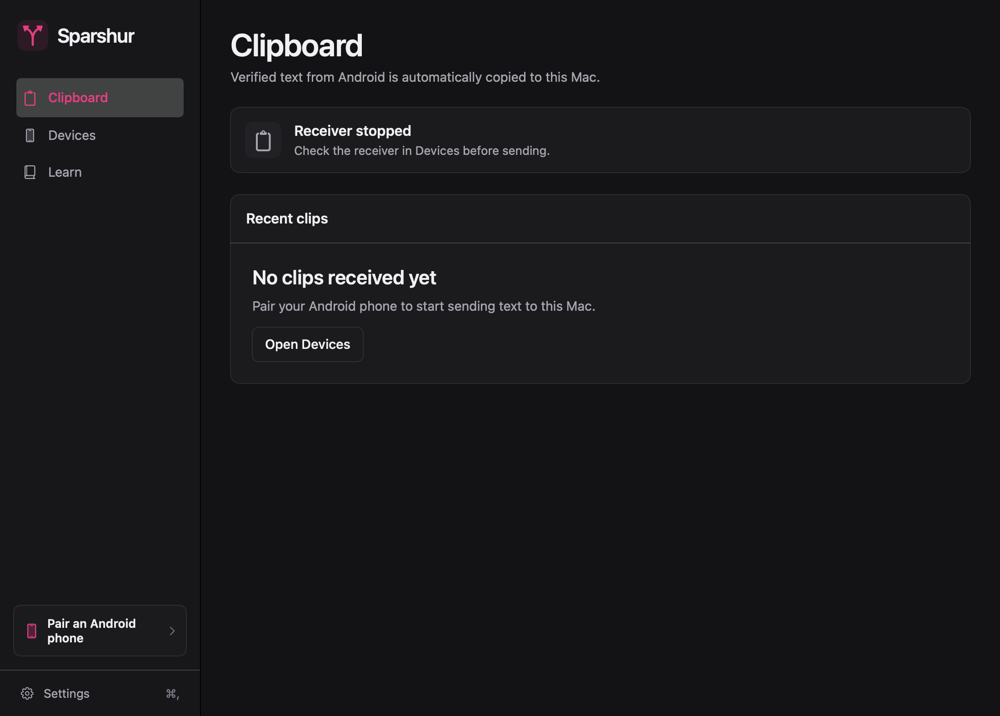

# Sparshur for Mac

The Mac app connects to the authenticated Go relay using the same transport as
Android. Read the
[implementation and security plan](docs/MAC_MINI_RELAY_PLAN.md),
[draft transport contract](spec/PROTOCOL.md), and
[transport decision](docs/adr/0002-relay-transport.md).
The outbound WebSocket/authentication layer is implemented; bidirectional encrypted
messaging still needs relay-compatible pairing, Android receiving keys and durable
endpoint processing. The local paired-v2 lesson below remains available.

Configure these environment
variables in the Xcode Run scheme (or the app's launch environment):

```text
SPARSHUR_RELAY_URL=wss://<your-valid-TLS-host>/v1/relay
SPARSHUR_RELAY_ID=<your-configured-relay-id>
```

Both must be present. No relay connection is attempted when both are absent.
Finder launches do not inherit your terminal's exported environment. No `.env`
loader is installed. The URL is not a credential and may not contain one.
Settings → Diagnostics shows relay status and provides Copy buttons for the
device ID and Base64 Ed25519 public key from the loaded identity. Enroll both
devices with the Go service's offline `relayctl` command. The Go relay and
both clients use the same exact URL and relay ID. Pause/sleep/quit stops it;
wake resumes only if receiving was previously active. Client networking is enabled
in App Sandbox; no TLS verification override or extra package was added.

An authenticated relay status proves connection authentication only. The app
deliberately rejects encrypted deliveries until the new endpoint protocol is
implemented and reviewed; local HTTP pairings are not silently relay-compatible.
Mini deployment and a live phone-to-Mac relay test are pending.

Native macOS 14+ SwiftUI app for the one-way Android → Mac local encryption lesson.
Charcoal surfaces, **#F72681**, dark appearance and shared **1.2×** typography.
Apple frameworks only; no remote packages. This learning protocol requires human
review and does not provide forward secrecy.



[Devices](docs/previews/pair-phone.png) · [Learn](docs/previews/learn.png)

## Run

Open `Sparshur.xcodeproj`, select **Sparshur → My Mac**, then Run.
The target uses **Sign to Run Locally**, App Sandbox and Incoming Connections.
No paid developer account or global developer-directory change is needed.

```sh
DEVELOPER_DIR=/Applications/Xcode.app/Contents/Developer \
  /Applications/Xcode.app/Contents/Developer/usr/bin/xcodebuild \
  -project Sparshur.xcodeproj -scheme Sparshur -configuration Debug \
  -destination 'platform=macOS' -derivedDataPath /private/tmp/SparshurDerivedData build
```

Quit the reference receiver before starting the app. Both share the existing
Keychain service `com.sparsh.bridge.learning.v2`, account
`identity-and-replay-state`. The app never creates a replacement identity.
If macOS denies access, choose **Authorize existing identity** and approve the
system Keychain prompt yourself. Rebuilt locally signed binaries may need fresh
authorization. Missing/inaccessible state leaves receiving unavailable.

Open **Devices**, select the address the phone can reach, and create a
five-minute QR. For devices on separate networks, connect both to the same
Tailscale network and select **Private VPN**. The Android build must support
paired-v2 VPN addresses. Scan and confirm on Android. The Mac marks pairing
saved only after verifying and persisting the handshake. The trusted manual
bundle is another way to transfer the same temporary secret; treat it like the QR.
Use the separately labeled `10.0.2.2` option for the Android emulator.
A listening socket does not prove hotspot, firewall or physical-phone reachability.

**Clipboard** copies verified text and recognized images from the paired phone.
Other attachments are available through **Save file…** in **Recent items**.
**Copy** lets you paste an earlier clip again. **Devices**
shows the saved phone, the time and route of its last verified contact this session,
and whether this Mac is listening. Direct transfers use short-lived connections.
Inspect shows the wire envelope and verification stages. Readable and phone-only
AES samples appear in **Learn**. Exact retries return signed duplicate receipts
without adding a row or writing the clipboard again. HTTP replies contain signed
receipts for verified clips.
History is memory-only, bounded to 40 observations; replay state persists in Keychain.

Sparshur restores the saved pairing and starts the receiver at app launch, even
with the main window closed. Android reuses the saved Mac address on its next
send. After restarting either app, send a new clip using the existing pairing.
A transfer interrupted by a shutdown may need to be sent again.

The menu-bar item shares the same receiver. Use **Open Sparshur** to reopen the
window, **Pause receiver** to stop receiving, and **Quit** to end the process.
Sleep pauses receiving and discards the QR. Wake resumes the receiver if it was
active. Quit the app before using the reference receiver. Pausing retains the
identity ownership guard.

Navigate with **⌘1/2/3**, **⌘,** Settings, **⌘[ / ⌘]** or **⌘{ / ⌘}**.
Back/Forward stay visible and disabled at history boundaries. A new destination
after Back clears forward history; lesson changes do not add screen entries.

## Verify and learn

```sh
DEVELOPER_DIR=/Applications/Xcode.app/Contents/Developer \
  /Applications/Xcode.app/Contents/Developer/Toolchains/XcodeDefault.xctoolchain/usr/bin/swift \
  test --scratch-path /private/tmp/sparshur-platform-tests

/Applications/Xcode.app/Contents/Developer/Toolchains/XcodeDefault.xctoolchain/usr/bin/swift-format \
  lint --strict --recursive Sparshur Tests tools/render-previews.swift Package.swift
```

Build/install the sibling Android debug and test APKs, boot its emulator, and quit
other recipients before running `python3 tools/test_android_native.py`.
This starts the signed native app itself; Python only orchestrates the test.
`--authorize-keychain` explicitly permits a system authorization prompt.
It pairs the emulator with the existing Mac identity, changing the saved phone
and pairing epoch. `--memory-only` tests transport with a temporary identity and
cannot prove Keychain migration or persistence across a real app restart.
Management uses inherited anonymous pipes in DEBUG builds, never LAN routes.

[Implementation and ordered reading guide](docs/IMPLEMENTATION.md) ·
[Evidence and remaining checks](docs/VERIFICATION.md) ·
[Design decisions](docs/adr/0001-native-receiver.md).

`zsh tools/render-previews.sh` renders only the app's own offscreen views, with no
fabricated inbox or usable QR. These layout checks complement interactive testing.
