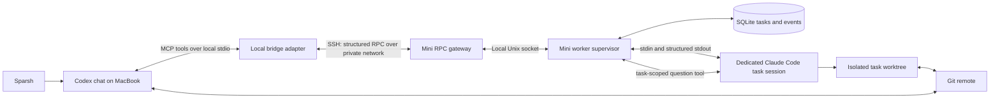

# Sparshur: Codex ↔ Claude Code development bridge

Date: 2026-10-24 (Asia/Kolkata)

Status: proposed architecture and implementation handover. No bridge, daemon,
credentials, remote connection, or background automation has been installed.

## 1. Intended experience

Sparsh gives Codex on the MacBook one instruction, for example:

> Build the agreed offline-delivery milestone. Delegate the Go relay to Claude
> Code on the Mac mini, implement the Mac and Android changes here, exchange
> questions directly, and return a tested integration for review.

Codex decomposes that authorized milestone, submits a bounded remote task,
continues local work, answers implementation questions, reviews the returned
commits, requests corrections, and runs interoperability tests. Sparsh does not
copy messages between terminals or manually start each Claude turn.

The first version supports this workflow while the Codex chat remains active.
The remote worker continues independently if the MacBook disconnects. Continuing
the coordinator after the chat ends is a separate extension, described below.

The development bridge is separate from Sparshur's application relay. Its queue
carries engineering tasks and results; the application relay carries opaque
encrypted device envelopes. They have separate processes, data, and credentials.

## 2. Selected architecture




The arrows describe application messages, not shared model memory. The bridge
forwards explicit task context, questions, answers, and results.


| Component                 | Location                              | Responsibility                                                                  |
| ------------------------- | ------------------------------------- | ------------------------------------------------------------------------------- |
| Codex coordinator         | MacBook, existing app chat            | Own the milestone, delegate relay work, implement clients, review and integrate |
| MCP adapter               | MacBook, started by Codex             | Expose bridge tools and translate calls into remote RPC                         |
| RPC gateway               | Mini, invoked through SSH             | Validate framed JSON requests and forward to a local socket                     |
| Worker supervisor         | Mini, managed by launchd              | Persist tasks, own processes/sessions, recover work, collect evidence           |
| Claude Code worker        | Mini, started as needed               | Implement a task in its dedicated worktree                                      |
| Local worker tool adapter | Mini, spawned for Claude              | Submit task-scoped questions/checkpoints to the supervisor                      |
| Git remote                | GitHub or another configured Git host | Exchange immutable source commits and reviewable branches                       |


Proposed implementation: a Go supervisor/RPC utility, SQLite state, and small
MCP adapters using a supported SDK. Select and pin adapter dependencies during
implementation. Start with one Claude task at a time on the 16 GB mini.

## 3. What actually listens


### MacBook → mini

The supervisor is the always-on listener. Claude Code itself does not need to sit
in an interactive terminal waiting for commands.

1. Codex calls `submit_task` through its configured local MCP adapter.
2. The adapter invokes a fixed SSH gateway command with a JSON request on stdin.
3. The gateway talks to the supervisor over a local Unix socket.
4. The supervisor commits the task and initial event to SQLite before replying.
5. Its worker loop claims the task and starts a Claude Code process.

Use ordinary SSH over a private network such as Tailscale. Use an explicit host
identity, pinned SSH host key, and dedicated key. No public HTTP listener is
needed for this design. A connection can be reused for efficiency, but task
lifetime must never depend on that SSH connection remaining open.

The SSH gateway accepts a small operation set. Do not interpolate prompts, branch
names, or repository content into shell commands. Pass JSON through stdin and
spawn subprocesses with argument arrays. Keep protocol stdout separate from logs.

### Mini → MacBook

The supervisor durably appends worker events. While Codex is active, it calls
`wait_events` with a cursor and a maximum 30-second wait. An event returns
immediately; otherwise the tool returns at the deadline. Codex does useful local
work between waits. Cursor reads are repeatable and do not consume messages.

This is bounded long polling. The mini does not need an inbound connection to
the MacBook, and both agents do not need to run permanent model inference loops.

If Claude needs an answer, its task-scoped tool records a question. Claude writes
a checkpoint and ends that turn. The supervisor waits without holding an LLM
call open. Codex receives the question through `wait_events`, sends a reply, and
the supervisor resumes the saved Claude session with that explicit answer.

The initial protocol deliberately exchanges messages between turns. Steering a
running Claude turn is deferred; new revisions queue until a turn boundary.
Cancellation is an explicit supervisor operation, not another queued prompt.

### A finished Codex chat is not a listener

MCP exposes callable tools. Configuring an MCP server does not itself give that
server a supported way to inject a new user message into an arbitrary idle app
chat. Do not claim notifications or shared files automatically restart this chat.

For v1, Codex remains active through the delegated milestone, within its runtime
and usage limits. If it stops, events remain on the mini and a later turn can
recover the task by ID. The supervisor reports coordinator absence; it does not
pretend the local client work continues.

## 4. MCP and remote operation contract

All names in this section are proposed bridge tools, not tools already installed.


| Codex tool                                                                    | Contract                                                                                                    |
| ----------------------------------------------------------------------------- | ----------------------------------------------------------------------------------------------------------- |
| `worker_health()`                                                             | Return daemon/CLI versions, auth readiness without secrets, project availability, queue depth, current task |
| `submit_task(request)`                                                        | Persist one authorized task; return task ID, state, revision, and event cursor quickly                      |
| `get_task(task_id)`                                                           | Return current checkpoint, session reference, result, and outstanding questions                             |
| `wait_events(task_id, after_event_id, timeout_seconds)`                       | Return ordered new events and next cursor; cap wait at 30 seconds                                           |
| `reply_to_question(task_id, question_id, answer, idempotency_key)`            | Persist an answer to that question and schedule a resume                                                    |
| `request_revision(task_id, instructions, expected_revision, idempotency_key)` | Queue bounded follow-up work in the same task/session                                                       |
| `cancel_task(task_id, idempotency_key)`                                       | Stop scheduling new work and interrupt the owned worker process                                             |


Claude receives a narrower local tool, `ask_coordinator`, bound by the supervisor
to its task and attempt. It can ask a question and attach a checkpoint. It cannot
choose another task ID, dispatch arbitrary agents, approve its own permission
requests, or send a new human instruction to Codex.

Every mutation is authorized to a configured caller and includes an idempotency
key. Reusing a key with a different payload returns a conflict. Task IDs identify
records; they are not credentials. Project IDs resolve
through an administrator-owned registry of Git remotes and local roots; callers
cannot submit arbitrary filesystem paths or executable commands.

Example task payload (illustrative paths assume the future monorepo):

```json
{
  "schema_version": 1,
  "idempotency_key": "offline-delivery-01/relay/initial",
  "project_id": "sparshur",
  "milestone_id": "offline-delivery-01",
  "base_commit": "<full Git commit SHA already published to the remote>",
  "task_kind": "implement_relay",
  "objective": "Implement the approved offline queue and delivery acknowledgements",
  "context_paths": ["AGENTS.md", "spec/PROTOCOL.md", "spec/vectors/"],
  "write_scope": ["relay/"],
  "acceptance": [
    "Delivery survives a relay restart",
    "Retrying a message does not duplicate the recipient operation",
    "Expired queued messages are removed"
  ],
  "constraints": [
    "Use the pinned protocol revision; ask before changing wire behavior",
    "No deployment or merge into the default branch"
  ],
  "verification_profile": "relay",
  "limits": {
    "wall_minutes": 60,
    "max_turns_per_attempt": 30,
    "max_revision_rounds": 3
  }
}
```

Verification profiles and resource limits are operator-owned configuration.
Agent requests can narrow permissions and limits, but cannot broaden them.
Path scopes guide work and restrict publication; they are not an OS sandbox.

Each event contains `schema_version`, `event_id`, `task_id`, `attempt_id`,
`task_revision`, `type`, `created_at`, and a bounded payload. Event types include
`started`, `checkpoint`, `question`, `permission_required`, `verification_failed`,
`ready_for_review`, `failed`, and `cancelled`. Use explicit question IDs and
structured outcomes; do not infer authorization or task success from prose.

## 5. Claude process and session ownership

The supervisor starts a dedicated non-interactive Claude Code session for each
task using its supported CLI interface. It captures structured output and the
session ID. A follow-up resumes that exact ID in the same worktree. Never use
"continue the most recent conversation" when multiple tasks may exist.

Conceptual invocation, not an installation command:

```text
spawn [absolute_claude_path, "-p", "--output-format", "stream-json",
       "--verbose", "--max-turns", configured_limit, ...approved_options]
cwd = isolated_task_worktree
stdin = explicit_task_context

follow-up: use the same options plus ["--resume", saved_session_id]
```

The runner owns the process from creation and parses supported output events.
It must classify authentication failures, permission denials, limit exhaustion,
malformed results, and actual successful outcomes separately. Exit code zero
alone is not proof that the requested feature was implemented.

A task can survive multiple CLI processes while keeping the same saved Claude
conversation. This avoids keeping an idle model call alive while awaiting input.
Never attach to, scrape, or type into Sparsh's manually opened Claude terminal.
An already installed/authenticated Claude Code is a prerequisite; unattended
operation under the supervisor's account must be verified separately.

No two processes may write the same worktree or resume the same session
concurrently. Each attempt records its process identity, session ID, checkpoint,
and exit outcome. On supervisor restart, fence recovery, reconcile any surviving
owned process, and only then decide whether a session can be resumed. Do not
start a duplicate process solely because a lease expired.

## 6. A complete autonomous milestone

1. **Sparsh assigns work.** Codex records the milestone, permitted scope, and
  acceptance criteria. Existing phase gates and cryptographic review rules
   remain applicable.
2. **Codex prepares a shared base.** Publish the reviewed spec and test vectors in
  a commit. Capture the exact SHA; resolve any uncommitted dependencies first.
3. **Codex dispatches.** `submit_task` sends the relay task; the supervisor returns
  a stable task ID without waiting for Claude to finish.
4. **The mini starts work.** Fetch the pinned commit, create a task branch/worktree,
  load shared guidance, and launch Claude. Codex works on clients locally.
5. **Claude asks a question.** For example, "Does the TTL apply from enqueue or
  original creation?" The question becomes an event; Claude checkpoints and ends
   its turn.
6. **Codex answers within authority.** Read the pinned spec and reply with its
  existing rule. If the answer requires a new protocol/crypto decision or user
   approval, report that to Sparsh instead of inventing authorization.
7. **Claude resumes.** The supervisor supplies the answer to the saved session;
  Claude completes implementation and local tests.
8. **The runner validates evidence.** Inspect the actual diff, run configured
  verification, record exit codes/log artifacts, and publish the permitted task
   branch to the configured Git remote. Permission/network failures remain visible.
9. **Codex integrates.** Fetch the returned SHA into a separate integration branch,
  inspect the changes, combine with client work, and run cross-platform tests.
10. **Agents repair failures.** Send Claude a revision containing the failing test,
  integration SHA, and relevant logs. It resumes its task. A changed base requires
    an explicit, recorded rebase/integration plan, not a silent pull of latest main.
11. **Codex reports the result.** Return reviewable changes and verification
  evidence. Stop at the task's authorization boundary. Do not infer approval to
    merge, deploy, change crypto, or advance a gated project phase.

These exchanges require no human message forwarding. They do require working
credentials, connectivity, available model usage, and bounded task authority.

## 7. State, reliability, and cancellation

Normal state progression:

```text
queued → preparing → running → verifying → ready_for_review → accepted
                         ↕                         ↓
               waiting_coordinator          revision_queued → running
                         ↕
                   waiting_user

Any applicable active state → failed | interrupted | cancelled
```

The coordinator accepts the final result after integration checks. A worker's
`ready_for_review` is not a successful whole-system release. Persist transitions
and associated events transactionally, including who authorized each mutation.

SQLite stores tasks, attempts, messages, events, publication results, and cursors.
Artifacts and CLI transcripts live in private task directories outside the Git
checkout; SQLite records their locations and hashes. Back up state and artifacts
together. Keep transcripts bounded and sanitize summaries before returning them.


| Failure                                | Required behavior                                                                       |
| -------------------------------------- | --------------------------------------------------------------------------------------- |
| SSH reply lost after submission        | Retry with same idempotency key; recover the original task                              |
| SSH connection drops                   | Worker continues under the mini supervisor; reconnect and replay events by cursor       |
| MacBook sleeps or chat ends            | Mini continues independent work; questions/results queue until coordinator resumes      |
| Mini restarts                          | Preserve worktree/checkpoint; reconcile process state before resuming                   |
| Claude hits rate/auth limits           | Record a blocked attempt; use bounded backoff where retryable, otherwise request action |
| Claude wants an unapproved operation   | Produce `permission_required`; never silently bypass permissions                        |
| Revision races completion              | Check revision and active attempt; serialize mutations or return a conflict             |
| Git push fails                         | Preserve the local commit; retry publication without rerunning implementation           |
| Worktree contains out-of-scope changes | Hold publication; surface the diff for correction/review                                |
| Coordinator retries a cancellation     | Return the recorded cancellation state; do not resurrect work                           |


Delivery is at-least-once with deduplicated requests. There is no exactly-once
guarantee for arbitrary shell side effects. Prefer resumable, inspectable steps.
Cancel with a graceful interrupt, then a bounded escalation against the owned
process tree if needed; preserve the worktree and partial artifacts. Closing an
MCP/SSH connection is not a cancellation.

## 8. Shared context and source exchange

Use separate clones on the two machines and a task worktree on the mini. Git
exchanges source; the task/event store exchanges live coordination. GitHub Issues
and PRs may mirror human-facing status later, but are not required as the live
message transport.

Each task pins its base commit, protocol revision, instructions, and relevant
test vectors. Both agents receive a concise milestone brief containing objectives,
non-goals, prior decisions, ownership, and unresolved questions. Each checkpoint
records actual commits, dirty state, verification evidence, and next steps.

The existing parent `CLAUDE.md` already imports `AGENTS.md`. Preserve that shared
instruction source and add task-specific context explicitly. A future monorepo
can simplify cross-platform commits; the bridge itself can start with a registry
of the current repositories. Do not silently move projects or assume the planned
monorepo paths already exist.

Do not claim zero context loss. Saved sessions preserve each agent's own history;
cross-agent understanding comes from explicit messages and shared artifacts.
If a saved session is unavailable, create a replacement using the latest durable
checkpoint and state that reconstruction occurred. Never fabricate continuity.

The task's returned result must include base SHA, result SHA, branch, changed
paths, evidence with real command exit codes, unresolved issues, and limits of
testing. The coordinator independently verifies important claims. Human knowledge
in unrecorded conversations is not transferred by cloning the repository.

## 9. Permissions and operation on the mini

The supervisor runs as a dedicated development user, not root. launchd manages
its lifetime; unattended startup and authentication after reboot must be tested.
A per-user LaunchAgent normally requires that user to log in; do not advertise
pre-login recovery unless a suitable service/authentication setup is verified.

Keep production relay credentials, real client private keys, and message data
outside the development account. Test with disposable identities. A task scope
or prompt is not filesystem/process isolation: enforce the account boundaries and
available sandbox/permission controls, and validate diffs before publication.

Preconfigure the permitted repositories, tool operations, verification profiles,
Git publishing destinations, and resource limits. Resume only with explicit
session IDs. Do not use a blanket permission-bypass switch to make automation
appear unattended. Capture denials as machine-readable events; if the CLI cannot
provide the needed permission lifecycle, switch the runner to the supported Claude
Agent SDK rather than parsing terminal prompts.

Project hooks, MCP configurations, and build scripts execute code. Load only
reviewed project configuration for unattended runs. Keep installed supervisor
binaries and policy operator-owned and outside task-writable directories. The
initial same-account runner assumes trusted development code: task tokens and
tool allowlists do not isolate it from other processes or files that account can
access. Stronger isolation requires a separately enforced worker account/sandbox
and a narrow process-launch mechanism; do not claim that boundary is already
provided by the queue. Claude's questions are worker input to evaluate, not new
instructions from Sparsh.

Autonomy limits apply across the whole task, not only each resumed process:
wall-clock runtime, model turns, revision rounds, concurrent workers, and configured
spending controls where supported. Store cumulative use. Provider estimates may
not equal final billing; avoid presenting a local cost cap as an exact guarantee.

## 10. Extension: coordination after the app chat stops

The v1 bridge does not restart this desktop conversation. If the requirement
becomes "continue coordinating while I close Codex," add a persistent coordinator
runner that owns a Codex SDK/app-server session and consumes the mini event queue.

That runner uses the same submit/read/reply operations, serializes turns, and
persists its own session ID and event cursor. It can run on an awake MacBook. To
continue while the MacBook sleeps, place the runner and the client build workspace
on the mini or another always-on host; having a mini-hosted model coordinator does
not grant access to an asleep laptop's files or tools.

Treat this as a separate managed session by default. Do not assume the SDK can
seize and resume any live desktop chat or that its transcript automatically
appears here. The desktop chat can submit the milestone and read its durable
status through the bridge. Validate any supported app/session attachment before
promising a unified live transcript.

The Codex SDK supports starting and resuming local threads. Integration with an
existing desktop conversation, background wakeups, authentication, and policy
must be verified for the actual installed app/runtime. No scheduling or persistent
coordinator has been created as part of this architecture document.

## 11. Implementation order and acceptance


| Step        | Deliverable                                               | Proof before expanding                                                                                         |
| ----------- | --------------------------------------------------------- | -------------------------------------------------------------------------------------------------------------- |
| 1           | Private connectivity, dedicated user, Git clone, CLI auth | Connect from MacBook and run a bounded read-only Claude task under the intended service account                |
| 2           | Durable supervisor, RPC gateway, SQLite events            | Submit/retry a task and recover the same task after disconnect                                                 |
| 3           | Local MCP adapter and Claude runner                       | From this Codex chat, submit a task and receive its result without opening a mini terminal                     |
| 4           | Questions, answers, explicit session resume               | Claude asks a question, Codex answers, same saved Claude session completes                                     |
| 5           | Worktree/branch/evidence lifecycle                        | Produce a permitted diff, verified tests, and a fetchable commit; Codex reviews locally                        |
| 6           | Integration and revision loop                             | A failing integration test triggers a bounded Claude revision and a verified fix                               |
| 7           | Recovery and permission handling                          | Demonstrate daemon restart, cursor replay, cancellation, authentication failure, and approval-required events  |
| 8, optional | Persistent Codex coordinator                              | Continue a milestone after the app chat ends, with explicit session ownership and a supported status interface |


The initial demonstration should be a disposable repository task with a
deterministic test and one deliberate clarification. It should not change the
Sparshur encryption protocol or deploy an application server. Only after the
bridge passes that demonstration should it take a bounded real relay milestone.

Suggested future source layout:

```text
tools/agent-bridge/
  supervisor/        Go service, SQLite state, task execution
  rpc/               Framed requests, fixed SSH gateway, local socket client
  mcp/               MacBook adapter and task-scoped Claude adapter
  schemas/           Versioned task, event, question, and result contracts
  fixtures/          Fake worker and disposable Git repository tests
  launchd/           Service templates with operator-supplied paths
  docs/              Setup, permissions, recovery, and operational runbook
```

This source tree is proposed, not created. A portable handover needs the schemas,
installation/runbook, configuration examples with no secrets, verified version
pins, and a transcript of the end-to-end acceptance demo.

## 12. Sources and capability boundaries

Checked 2026-10-24. Product documentation supports the integration primitives;
the queue, RPC protocol, recovery rules, and lifecycle above are our proposed
architecture, not a built-in Codex/Claude cross-vendor messaging feature.

- [Codex MCP integration](https://learn.chatgpt.com/docs/extend/mcp): local stdio
and HTTP MCP servers, connection configuration, timeouts, tool controls.
- [Claude programmatic operation](https://code.claude.com/docs/en/headless):
non-interactive runs, structured output, explicit session resume.
- [Claude CLI reference](https://code.claude.com/docs/en/cli-reference): relevant
process options and resource controls; verify against the installed version.
- [Codex SDK](https://learn.chatgpt.com/docs/codex-sdk): starting and resuming
programmatically controlled Codex threads for the optional coordinator.

